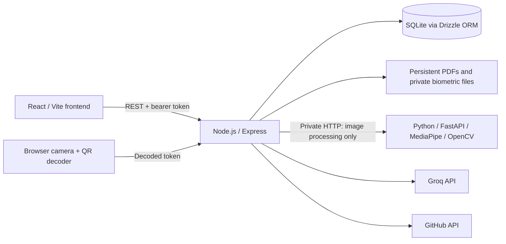

# HackManager: frontend redesign and Express migration

Status: implementation in progress. Express foundation and a connected event/team/submission/check-in preview are implemented and browser-tested. See [migration status](migration-status.md) for the exact completed scope and remaining work; full cutover is not complete.

Prepared: 26 October 2026. Based on the current repository, including the ivory/cobalt landing page and the earlier shared-service refactor.

## 1. Outcome and working assumptions

Deliver a consistent light frontend and replace Django with Node.js + Express for the application backend. Retain a small Python service for the existing MediaPipe/OpenCV face processing. Keep the project understandable for a college team, with ordinary REST endpoints, a local database, and documented startup commands.

Assumptions for planning:

- Preserve existing accounts, event records, submissions, uploaded PDFs, and face registrations. Do not start with an empty database.
- Preserve browser routes and the student, judge, and admin roles. Internal filenames may change.
- Start with a single Express process and SQLite. A managed database is a later deployment choice, not a prerequisite for the college demo.
- Retain React, Vite, TypeScript, Tailwind, shadcn/ui, React Router, and Framer Motion. No frontend framework rewrite.
- Work against copies of existing data while Django remains the reference implementation. No simultaneous Django/Express writes to one database.
- Complete this as reviewable phases. The new backend is switched into normal use only after its dependent workflows work end to end.

## 2. What the existing code means for the migration

| Current area | Evidence in the repository | Consequence |
|---|---|---|
| Landing design | `Frontend/src/styles/landing.css`, `components/landing/` | Extract reusable tokens and layouts from the approved design rather than duplicating its CSS across pages. |
| Remaining pages | Dark variables in `src/index.css`; repeated `sidebarItems` in page components | A shared application layout and navigation configuration should precede individual page redesigns. |
| Auth | `backend/accounts/auth_views.py`, `serializers.py`, `models.py` | Preserve email login, names, roles, optional unique phone numbers, and existing password hashes. |
| Actual business data | `Frontend/src/lib/hackathonStore.ts` and Django `SharedState` | Much of the backend migration is converting browser business operations and stored JSON into Express APIs, not translating Django views alone. |
| Synchronization | Global storage method interception and 3-second polling in `src/App.tsx` | Remove the global interception only after all consumers use API/query hooks. |
| QR | `react-qr-code`, `html5-qrcode`, `MyQR.tsx`, `AdminQRMonitor.tsx` | Keep QR rendering and camera decoding in React; move token validation and redemption to Express. No Python QR service is necessary. |
| Face processing | `face_views.py`, `face_utils.py`, model asset and on-disk embeddings | Reuse image decoding, detection, normalization, and comparison in Python; Express owns identity, permission checks, and persistence. |
| AI | `src/lib/ai.ts` calls Groq and GitHub directly | Move credentials, prompts, content fetching, and evaluation orchestration to Express. Frontend keeps display and interaction. |
| PDF extraction | `extractPDFContent` currently uses a binary-text regex | Replace the heuristic with a PDF parser in Node. OCR is not required for the existing PDF upload feature. |
| Support | `GrievanceSupport`, `Helpline`, and the admin event page already share ticket helpers | Share ticket UI and APIs; import any older grievance records without silently losing them. |

## 3. Proposed architecture and decisions



### Decision A: TypeScript Express application with feature modules

Use Node 24 LTS, Express 5, TypeScript, Zod validation, and one database client. Add multipart handling, JWT support, CORS, request limits, and a single error middleware. Pin compatible package versions during setup. Express 5's supported Node baseline and Node's supported-release policy are documented in the [Express migration guide](https://expressjs.com/en/guide/migrating-5/) and [Node release schedule](https://nodejs.org/en/about/previous-releases).

Organize code by feature: auth, hackathons, teams, submissions, judging, check-in, support, notifications, AI, and biometrics. Start with a route file and a service file per feature; add schemas when needed. Do not require controllers, repositories, factories, and interfaces for every trivial operation. The trade-off is one deployable application rather than independently deployed business services; that is appropriate for this project's size.

### Decision B: keep SQLite, use Drizzle ORM for explicit schema and migrations

Use a new SQLite database with a TypeScript Drizzle schema and generated SQL migrations, and import validated legacy data into it. Preserve the original database as the migration source. Drizzle supports the existing `better-sqlite3` driver and generated migrations; see the [official SQLite setup](https://orm.drizzle.team/docs/sqlite/get-started-sqlite) and [migration guide](https://orm.drizzle.team/docs/migrations).

This avoids adding a database server to the college setup. The accepted limit is single-instance deployment and modest concurrent writes. Use database constraints and transactions for registration and QR redemption. Revisit PostgreSQL if multiple API instances or sustained write contention become necessary; that would be a separate migration, not just an environment-variable change.

### Decision C: retain Python only for face processing

Run a persistent internal FastAPI service with Python 3.11, `mediapipe==0.10.20`, and `numpy==1.26.4`. Keep OpenCV and the known model asset. FastAPI supports multipart uploaded files through `UploadFile`; see its [file handling documentation](https://fastapi.tiangolo.com/tutorial/request-files/).

Keep the detector warm and reuse it. Bound concurrent calls and protect detector access rather than launching a Python process for every image. A second process is the main operational cost; it avoids reimplementing the existing native vision pipeline in JavaScript.

### Decision D: shared design tokens and React Query

Use the landing page's colors, typography, borders, and motion vocabulary throughout the app. Use the installed TanStack Query for server state, cache invalidation, and narrow polling of active event views. Its [query invalidation mechanism](https://tanstack.com/query/latest/docs/framework/react/guides/query-invalidation) replaces manual global storage-event refreshes.

Keep localStorage only for small preferences such as selected event and sidebar state, plus the existing bearer-token transport during this migration. Validate the session with `/api/auth/me`; do not treat the cached user object as proof of authentication. Use no new Redux store, websocket server, or generic component framework.

## 4. Frontend design system

### Shared visual rules

| Element | Target |
|---|---|
| Page background | Ivory `#f8f8f0` |
| Primary action / selected state | Cobalt `#294eea` with white text |
| Main text | Ink `#24271f` |
| Secondary text | `#65685e`, checked for contrast at the actual font size |
| Supporting surfaces | White, pale sage, pale blue; peach for occasional highlights |
| Borders and shadows | Fine neutral borders, restrained shadows, no dark glass/neon effects |
| Type | Space Grotesk headings; Inter body, forms, tables |
| Data-heavy screens | Compact headings and clear 14–16px body text; do not reuse the marketing hero's tiny labels for essential data |
| Motion | Short entry transitions and state changes; honor reduced motion |
| 3D | Retain the landing hero; optional small empty-state illustrations only. No constantly moving scene behind forms, tables, or camera previews. |

Extract shared colors into `styles/tokens.css`; map existing Tailwind/shadcn CSS variables to those values. Keep `landing.css` for landing-specific geometry and composition. Update portal-based dialogs, popovers, tooltips, and toasts through global tokens so they do not retain dark backgrounds.

Create only components with multiple callers:

- `PublicLayout`: shared header, content width, footer.
- `DashboardLayout`: role navigation, header, selected-event control, responsive sidebar/drawer, main content.
- `PageHeader`, `EmptyState`, `StatusBadge`, and common loading/error states.
- Feature components such as `TicketThread`, `SubmissionCard`, `CameraCapture`, and `FaceVerificationDialog` where repeated workflows already exist.
- `config/navigation.ts`: one list per role; remove page-level copies.

Continue importing existing shadcn primitives. Do not manually edit `components/ui/`; theme them through variables and compose them at the feature level.

### Page-by-page coverage

Browser URLs remain stable while source files get clearer names.

| Current page | Proposed location/name | Redesign and preserved behavior |
|---|---|---|
| `Index` | `pages/public/HomePage.tsx` | Preserve approved landing appearance and links; consume extracted tokens. |
| `Hackathons` | `pages/public/HackathonsPage.tsx` | Light event cards, clear dates/status, existing registration entry points; label external sample listings as examples. |
| `Leaderboard` | `pages/public/LeaderboardPage.tsx` | Accessible light table, selected-event control, consistent score calculation and empty state. |
| `RoleSelect` | `pages/auth/RoleSelectPage.tsx` | Three light role cards with clear entry paths. |
| `Auth` | `pages/auth/AuthPage.tsx` | Matching login/signup layout, visible labels and validation; preserve role query parameters. Explain restricted admin/judge onboarding. |
| `StudentDashboard` | `pages/student/StudentDashboardPage.tsx` | Selected event, team details, rounds, member editing/removal, and next actions. |
| `PPTUpload` | `pages/student/PresentationUploadPage.tsx` | Clear PDF/link modes, round/deadline state, progress, retry, and saved-submission preview. |
| `student/GitHubRepo` | `pages/student/RepositorySubmissionPage.tsx` | Repo entry, validation, saved state, and external link. |
| `student/FaceVerify` | `pages/student/FaceRegistrationPage.tsx` | Name reflects actual enrollment; camera permission, capture, confirmation, and existing-registration states. |
| `student/MyQR` | `pages/student/EntryPassPage.tsx` | High-contrast entry QR, token expiry, meal progression, and used/invalid states. |
| `student/Notifications` | `pages/student/NotificationsPage.tsx` | Readable announcement list scoped to event. |
| `student/GrievanceSupport` | `pages/student/SupportPage.tsx` | Ticket list/create/thread and AI help, using common support components. |
| `student/LinkedInPost` | `pages/student/LinkedInPostPage.tsx` | Event selector, generation state, editable post and copy action. |
| `JudgeDashboard` | `pages/judge/JudgeDashboardPage.tsx` | Assignment list, presentation/repo viewer, AI review, scoring, and project chat. |
| `AdminDashboard` | `pages/admin/AdminDashboardPage.tsx` | Event overview, existing create/delete/reset actions with confirmation and clear scope. |
| `AddHackathon` | `pages/admin/CreateHackathonPage.tsx` | Grouped event setup, dates, team limits, and round forms. |
| `HackathonDetail` | `pages/admin/HackathonDetailPage.tsx` | Extract participants, rounds, criteria, judges, announcements, results/export, and tickets into feature panels. |
| `AdminQRMonitor` | `pages/admin/CheckInMonitorPage.tsx` | Camera scanner, scan log, result feedback, face verification, and clearly labeled simulator. |
| `Helpline` | `pages/shared/HelpdeskPage.tsx` | Role-aware support workspace reusing ticket components; preserve existing shared route. |
| `NotFound` | `pages/public/NotFoundPage.tsx` | Matching light empty state with navigation back. |

Every page includes loading, empty, error, and populated states. Keyboard focus, dialog focus return, touch controls, narrow tables, and camera cleanup are acceptance requirements, not a final cosmetic pass.

## 5. Backend ownership and contracts

### Existing endpoint transition

| Current endpoint | Express destination / decision |
|---|---|
| `POST /api/auth/signup/` | Preserve path and core fields; validate and hash in Node. Public signup creates students; bootstrap/admin-managed workflows provision elevated roles. |
| `POST /api/auth/login/` | Preserve `access`, `role`, `email`, `username` for the current client adapter. Define token expiry and error handling explicitly. |
| `POST /api/auth/pdf-upload/` | Preserve URL/filename response initially; require authenticated ownership. Retain 10MB PDF limit and add file-content validation. |
| `POST /api/face/register[/]` | Express authorizes enrollment, calls Python, and persists the resulting registration. Accept both existing slash forms. |
| `POST /api/face/verify[/]` | Express authorizes the target participant, calls Python, applies a server-owned threshold, and records verification. |
| `GET/POST /api/auth/sync/` | Export/import its data during migration; retire the endpoint at final cutover. Do not recreate an unrestricted shared JSON API as the new architecture. |
| `/media/...` | Preserve valid old presentation references through a controlled mapping; serve authorized files in both development and production. |

Add `/api/auth/me` for session restoration. Old Django access/refresh tokens are intentionally invalidated at cutover; users log in again with their existing passwords. Do not promise refresh-token support unless both its API and client lifecycle are implemented; the current client discards the refresh token.

For new APIs, use a consistent error shape such as `{ error: { code, message, fields? } }`. Keep compatibility response adaptation at the existing auth/media boundary rather than throughout the business logic. Validate bodies, query parameters, multipart metadata, and responses from external providers.

### Domain API inventory

| Area | Required operations |
|---|---|
| Events | List/public detail, create, edit, delete; rounds and evaluation criteria; current-user event membership. |
| Teams | Register, list authorized participants, edit/remove members, registration/shortlist status; member-account linking. |
| Submissions | Submit/update PDF or presentation link per round; repository submission; authorized download/view; invalidate affected AI caches. |
| Judges | Provision/link judges, assign/unassign teams, fetch own assignments, save scores/feedback. |
| Results | Fetch rankings and export CSV from the same server calculation. |
| Check-in | Issue entry/meal tokens, redeem, query token state and scan log/statistics. |
| Notifications | Create announcements; list announcements for the selected event. |
| Support | Create/list/read tickets, add messages, update status; scope participant access to their own tickets. |
| AI | Evaluate a submission, repository chat/snapshot, support chat, LinkedIn draft; cache by actual submission version. |
| Biometrics | Enrollment state, enrollment/re-enrollment policy, authorized verification, optional scoped identification if existing use requires it. |
| Demo administration | Explicit reset/seed workflow, bounded to demo data and protected by confirmation; never clear real accounts or biometric files implicitly. |

Representative routes: `/api/hackathons`, `/api/hackathons/:id/registrations`, `/api/registrations/:id/members`, `/api/submissions`, `/api/judge-assignments`, `/api/judge-assignments/:id/score`, `/api/hackathons/:id/leaderboard`, `/api/check-ins/redeem`, `/api/tickets/:id/messages`. Record exact request/response schemas in `docs/api-contracts.md` before connecting each frontend feature.

### Schema and identity rules

Use explicit records for users, hackathons, rounds, criteria, registrations, members, submissions, event judges, assignments, scores, QR tokens/redemptions, scan logs, announcements, tickets/messages, and generated AI content. Keep provider output and content snapshots as validated JSON/text where appropriate; do not normalize every AI sentence into a table.

- Use IDs for relationships; keep email as a unique login/contact field, not a file path or a team identifier.
- A member may exist before they have an account. Preserve their details with an optional linked user ID; do not invent accounts or passwords for them.
- Protect duplicate registration/member constraints within an event. Confirm the intended team-membership rule against existing fixtures before enforcing it on historical records.
- Include event and round context in assignments/scores. Legacy records without a round receive an explicit legacy mapping or an import warning, not an arbitrarily chosen round.
- Store verification status separately from shortlist/registration status. Preserve the old values in the import report where they conflated those concepts.
- Add foreign keys, relevant unique indexes, and transactions around operations that must succeed together.

### QR and scoring behavior that needs one authoritative implementation

Keep camera capture/QR rendering in React. Express issues opaque or signed tokens with event, participant, purpose, and expiry; redemption is a transaction with a uniqueness constraint so two scanners cannot both consume the same pass. Preserve entry-before-meals and configured meal ordering. Generate new-format tokens after cutover while preserving already-used state. QR generation must not itself count as a successful scan.

Calculate rankings once in `judging.service.ts`. The current public/admin pages repeatedly average pairs, and the judge page displays a fixed 50/50 combination. Proposed consistent rule: arithmetic mean of completed human evaluations, the event's configured AI weight, stable team IDs, and explicit pending status when a required score is missing. Document tie handling and round aggregation with fixtures before rollout. This is an intentional correctness change, not merely a visual refactor.

### Python boundary

Extract pure logic from `get_landmarker_or_mesh`, `get_normalized_embedding`, and `decode_uploaded_image`. Remove DRF request/response objects, Django settings, user roles, and email-derived filesystem access from that code.

- Private `POST /internal/face/embedding`: bounded image upload → validated numeric embedding and quality result.
- Private `POST /internal/face/compare`: image plus authorized reference embedding(s) → similarity/quality result. Express decides success using configured thresholds.
- Express persists private reference images/embeddings using stable user IDs. Python has the model asset, not independent user or hackathon state.
- Require a service credential and bind to localhost/private network. The browser talks only to Express.
- Set request deadlines, input/pixel limits, bounded concurrency, and health/readiness checks. A vision-service failure produces an actionable unavailable response.
- Remove the duplicated browser grayscale “verification succeeded” fallback. Camera/network failure must not become a successful identity check.
- Preserve the current model and normalization for migration compatibility. Validate true/false match behavior with consented fixtures before any threshold change; this plan does not add liveness detection or claim biometric accuracy.
- Consolidate the two model-file locations only after comparing checksums and verifying the chosen asset works. Keep the required binary tracked.

### AI and PDF handling

Move Groq requests and `GROQ_API_KEY` into Express. Use Node's HTTP client for GitHub and Groq, validate model output, bound prompt/content sizes, and cache evaluations against a submission version. Use current supported provider model names as configuration checked during implementation, not the old fallback list copied blindly.

Parse PDFs with a maintained Node PDF parser chosen against representative existing PDFs. Image-only PDFs should say text is unavailable and remain manually reviewable; OCR can be added later if needed. Prefer uploaded file IDs over fetching arbitrary URLs on the server. Allowlist GitHub hosts, bound redirects/downloads, and reject private-network destinations for any server URL-fetching feature.

No Python is needed for QR, JWTs, user management, uploads, database access, or calling an LLM API.

## 6. Data-preserving migration

1. **Inventory and backup.** Snapshot SQLite consistently, PDFs, face images, embeddings, and model assets. Capture a manifest of counts, keys, file hashes, and schema versions without putting personal data or secrets in Git.
2. **Capture browser-only data.** Export relevant `sq_*`, `global_hackathons`, and `user_registrations` records from the browsers whose unsynced work must be retained. Device-local data cannot be recovered from the server alone. Keep UI preferences separate from shared event data.
3. **Dry-run import.** Read the source without modifying it. Resolve legacy IDs/email-based references with a migration map. Prefer the frozen server snapshot for synchronized data; import browser-only records, and report conflicting versions for review rather than selecting silently. Quarantine malformed JSON, duplicate identities, ambiguous assignments, and missing media with reasons.
4. **Preserve passwords.** Inventory stored hash algorithms without printing hashes. Implement and test a compatible verifier for the formats actually present. Django documents its encoded password format in [password management](https://docs.djangoproject.com/en/5.2/topics/auth/passwords/). For supported PBKDF2-SHA256 records, preserve salt/iteration/digest encoding exactly, then rehash with bcrypt after a successful login. Unsupported or unusable hashes receive an explicit recovery path, never an invented default password.
5. **Import into a new database.** Create the target schema with migrations, then import accounts and relational event data in dependency order. Keep an idempotent source-to-target mapping and a report of imported/rejected records. Re-running must not duplicate rows. Convert valid legacy base64 PDFs/images to private files and update references; retain originals until reconciliation passes.
6. **Validate assets and ownership.** Check media checksums and downloadability. Map email-named face files to user IDs; verify vector dimension/model compatibility. Assign legacy event ownership explicitly because current records do not consistently record it. Preserve legacy ticket/grievance content without presenting duplicate tickets.
7. **Reconcile.** Compare counts, per-event membership, assignments, submission links, used QR states, and representative score outputs. Distinguish expected scoring-rule changes from lost data. Confirm existing-user login with test accounts, not by exposing real credentials.
8. **Freeze and switch.** Pause writes, capture the final delta/snapshot, import, validate, and change the frontend API base URL to Express. Invalidate old sessions; regenerate valid QR payloads without resetting consumed passes. Keep Django and the backup available for recovery.
9. **Retire old persistence.** Remove global localStorage interception, global sync polling, and business-data writes from the frontend. Clear migrated local records only after a recorded successful migration; keep user-recoverable exports until sign-off.

Rollback boundary: before new Express writes, restore the old frontend/backend configuration and frozen data snapshot. After Express has accepted new writes, rolling back binaries alone would lose those changes; freeze again and export/reconcile them first. Do not advertise an automatic data-safe rollback without testing a reverse migration.

## 7. Target project structure

```text
HackManager/
├── frontend/                     # rename Frontend in a separate path-only step
│   └── src/
│       ├── app/                  # routes and providers
│       ├── pages/                # public/, auth/, student/, judge/, admin/, shared/
│       ├── components/
│       │   ├── ui/               # existing shadcn primitives
│       │   ├── landing/          # existing 3D hero and marketing components
│       │   ├── layout/           # PublicLayout, DashboardLayout, navigation
│       │   └── shared/           # proven reusable page elements
│       ├── features/             # event, submission, judging, check-in, support UI
│       ├── services/             # typed HTTP calls grouped by feature
│       ├── hooks/                # query/mutation and shared camera hooks
│       ├── config/navigation.ts
│       ├── types/                # application DTOs
│       ├── lib/                  # small, genuinely generic helpers
│       └── styles/               # tokens.css, app.css, landing.css
├── backend/                      # Express replaces Django after cutover
│   ├── src/
│   │   ├── app.ts                # app setup; no port binding, easy to test
│   │   ├── server.ts             # startup and shutdown
│   │   ├── config/               # env validation and database client
│   │   ├── middleware/           # auth, validation, errors
│   │   ├── modules/              # auth/, hackathons/, teams/, submissions/, etc.
│   │   └── integrations/         # faceService.ts, groq.ts, github.ts
│   ├── drizzle/                  # generated, versioned SQL migrations
│   ├── src/db/schema.ts           # Drizzle table definitions
│   ├── scripts/                  # importLegacyData.ts, seedDemo.ts
│   ├── tests/
│   └── Dockerfile
├── services/face-service/
│   ├── app.py                    # small private FastAPI adapter
│   ├── face_processing.py        # detector, embeddings, comparison
│   ├── image_utils.py            # existing decoding helper
│   ├── models/face_landmarker.task
│   ├── tests/
│   ├── requirements.txt
│   └── Dockerfile
├── data/                         # ignored persistent runtime data
│   ├── hackmanager.db
│   ├── uploads/
│   └── biometrics/
├── docs/                         # plan, API contracts, migration and setup guides
├── compose.yaml                  # Express + private face service, persistent volumes
└── README.md
```

Build Express initially in `backend-node/` while `backend/` still contains Django. Move it to the final name only after cutover acceptance. Preserve the old backend in an identified commit/snapshot, not by leaving two active `backend` implementations. Handle the `Frontend` → `frontend` case-only rename using a temporary name on Windows, and update deployment roots and documentation in the same change.

## 8. Implementation sequence and completion gates

| Phase | Work | Completion gate |
|---|---|---|
| 0. Baseline | Inventory routes/workflows, create representative fixtures, record screenshots, verify backups, document legacy API contracts and known lint failures. | A runnable baseline and a tested restore path exist. |
| 1. Shared visual foundation | Extract tokens; build public/dashboard layouts; centralize navigation; theme overlays/forms/tables; retain landing appearance. | Landing, auth, and one dashboard render consistently at mobile/tablet/desktop sizes. |
| 2. Frontend page rollout | Redesign public/auth → student → admin → judge/support pages in coherent batches; extract repeated feature components; retain existing data adapters temporarily. | Every page in the coverage table has matching light styling and its existing actions still work against the baseline. |
| 3. Express + Python foundation | Create `backend-node`; set up configuration/database/migrations; implement auth/media compatibility, `/me`, private face adapter, and contract tests. | Existing-account fixture login, PDF upload/download, and face fixture calls pass through Express. |
| 4. Event/team/submission vertical slice | Implement event, rounds, members, submission APIs and importer; connect corresponding React Query hooks and replace those storage callers. | Organizer creates an event; a student registers and submits; organizer sees the result from a second browser. |
| 5. Judging/check-in/support slice | Implement assignments, authoritative scores/results, QR issuance/redemption, announcements, tickets, and AI integrations; connect remaining pages. | Judge evaluates a team; both result views agree; duplicate scan is rejected; ticket/reply and notifications persist. |
| 6. Migration rehearsal | Import full copies, resolve conflicts, validate media/hashes/ownership, test unavailable AI/face services and restart persistence. | No unexplained record loss, no silent verification fallback, all required workflows pass. |
| 7. Cutover and cleanup | Freeze/import/switch; retire Django and shared sync; finalize directory names, Docker/startup scripts, README/AGENTS/DEPLOYMENT, CI, and ignored runtime paths. | Fresh setup works from documentation; no Django runtime dependency or business localStorage write remains. |

Phases 1–2 can proceed independently of backend implementation, but do not combine a large visual rewrite and data-source rewrite into one unreviewable change. Backend feature slices must include their frontend callers, tests, and migration rules before being considered complete.

## 9. Validation and definition of done

Frontend:

- TypeScript, production build, tests, and lint for changed code pass; document remaining baseline failures rather than disabling rules globally.
- Review every page/state at 390px, 768px, and 1440px, plus a 320px overflow check. Verify the landing page remains visually consistent after token extraction.
- Test keyboard navigation, labels/errors, modal focus, portal colors, reduced motion, mobile menus, camera permissions, and camera-track cleanup.
- Route navigation preserves selected event appropriately and does not leak another user's cached data after logout/login.

Backend and migration:

- API tests cover roles/ownership, invalid inputs, duplicate registration, concurrent QR redemption, upload limits and retrieval, score aggregation, and ticket access.
- Test imported-password verification against Django-generated fixtures, including wrong passwords and unsupported hash formats.
- Import dry-run, repeat-run idempotency, broken references, legacy IDs, missing files, and reconciliation reports are covered with synthetic fixtures.
- Vision tests cover malformed/no-face/multiple-face inputs, model compatibility, reference lookup, and service timeout; a manual camera check verifies the actual capture workflow.
- AI tests use mocked provider responses for timeout, rate limits, malformed output, and cache invalidation. Verify no Groq key remains in the frontend build.
- Integration tests run the complete organizer → student → judge journey, QR entry/meals, support replies, and persistence after restart.
- Deployment includes persistent data volumes, localhost/private vision access, explicit CORS origins, health checks, and frontend SPA route fallback. Node uses `PORT`; model readiness failure must not prevent unrelated event pages from working.

Final removal checks: no Django/DRF startup, no direct frontend Groq requests, no anonymous global state endpoint, no browser writes to authoritative scores/check-ins, and no duplicated navigation or face-comparison code in pages. Existing uploaded/biometric data and required model assets remain accounted for.

## 10. Boundaries and implementation-time choices

This plan deliberately excludes a React framework upgrade, custom WebGL engine, OCR, liveness detection, email-invitation infrastructure, Redis, Kafka, Kubernetes, and websocket synchronization. Add those only for a demonstrated requirement.

Confirm hosting constraints and the need to preserve browser-only records at the migration checkpoint. If the target host cannot provide persistent disk for SQLite and uploads, choose the storage alternative before cutover. Neither this document nor the current code review validates the deployed data, face-recognition accuracy, or a real migration run.

The architecture skills informed the single Express application, the narrow Python boundary, explicit contracts, and phased migration/rollback gates. The React guidance informed shared layouts, direct feature imports, React Query, and accessible restrained motion.
