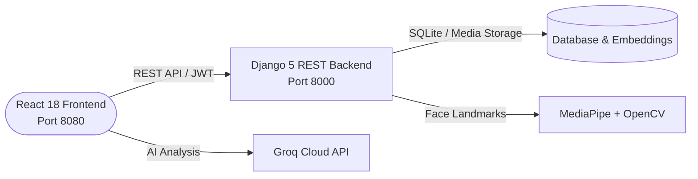

> Historical reference. Current setup and deployment are in the repository root.

# HackManager 🚀

> **Migration in progress:** `VITE_BACKEND_MODE=express` connects the frontend to Node/Express + Drizzle for events, teams, submissions, and check-in. Start with [Express setup and Playwright checks](docs/express-development.md) and [migration status](docs/migration-status.md). The feature list and Django instructions below describe the retained legacy version; not every feature has been migrated. Use `VITE_BACKEND_MODE=django` only with the Django API.

A comprehensive, full-stack Hackathon Management Platform featuring role-based portals for **Students**, **Judges**, and **Admins**, biometric face verification powered by **MediaPipe & OpenCV**, real-time **QR attendance monitoring**, and **Groq AI-powered intelligence** for PPT evaluation, repository analysis, and helpline support.

---

## 📑 Table of Contents

- [Features](#-features)
- [Architecture & Tech Stack](#-architecture--tech-stack)
- [Project Structure](#-project-structure)
- [Prerequisites](#-prerequisites)
- [Quick Start Guide](#-quick-start-guide)
  - [1. Backend Setup (Django)](#1-backend-setup-django)
  - [2. Frontend Setup (React + Vite)](#2-frontend-setup-react--vite)
- [Environment Variables](#-environment-variables)
- [API Endpoints](#-api-endpoints)
- [Docker Deployment](#-docker-deployment)
- [Troubleshooting & FAQs](#-troubleshooting--faqs)

---

## ✨ Features

- 👥 **Role-Based Portals**:
  - **Student**: View registered hackathons, generate attendee QR codes, verify biometric face scans, submit project links/presentations, generate automated LinkedIn posts, and interact with the AI assistant.
  - **Judge**: Review submissions, evaluate project PPTs, assign criterion-based scores, and submit feedback.
  - **Admin / Organizer**: Create and manage hackathons, monitor real-time QR attendance check-ins, manage rounds, and sync state across all devices.
- 👤 **Biometric Face Verification**:
  - Face registration and 1-to-1 or 1-to-many facial similarity verification using **Google MediaPipe Face Landmarker** and **OpenCV**.
- 📲 **QR Attendance & Scanner System**:
  - Dynamic student QR generation and camera-based Admin QR scanner for check-ins and meal/round tracking.
- 🤖 **Groq AI Capabilities**:
  - Automated presentation evaluation and scoring.
  - GitHub repository code analyzer & project chatbot.
  - 24/7 AI-powered grievance and hackathon helpline.
- 🔄 **State Synchronization**:
  - Synchronizes platform state and round data across multiple devices and browsers via dedicated backend sync endpoints.

---

## 🛠 Architecture & Tech Stack



### Frontend
- **Framework**: React 18 with TypeScript
- **Bundler & Dev Server**: Vite (Configured on port `8080`)
- **Styling**: Tailwind CSS + `shadcn/ui` + Radix UI primitives
- **Icons & Motion**: Lucide React, Framer Motion
- **Data & State**: TanStack React Query, React Router DOM v6

### Backend
- **Framework**: Django 5.x & Django REST Framework (DRF)
- **Authentication**: SimpleJWT (JSON Web Tokens)
- **Computer Vision & Biometrics**: MediaPipe (`0.10.20`), OpenCV Headless, NumPy (`1.26.4`)
- **Static Assets & CORS**: WhiteNoise, django-cors-headers
- **WSGI / Production**: Gunicorn

---

## 📂 Project Structure

```text
HackManager/
├── backend/
│   ├── accounts/              # Django app handling users, auth, face scans & media
│   │   ├── face_views.py      # MediaPipe & OpenCV face registration/verification
│   │   ├── media_views.py     # PDF presentation upload handler
│   │   ├── models.py          # Custom User model & SharedState model
│   │   ├── serializers.py     # Authentication & registration validation
│   │   ├── urls.py            # Account API routes
│   │   └── views.py           # Login, Signup, and State Sync views
│   ├── backend/               # Project configuration (settings, ASGI, WSGI, URLs)
│   ├── db.sqlite3             # Local SQLite database
│   ├── face_landmarker.task   # MediaPipe task model asset
│   ├── Dockerfile             # Container definition for backend
│   ├── manage.py              # Django management CLI
│   └── requirements.txt       # Python dependencies
├── Frontend/
│   ├── src/
│   │   ├── components/        # Reusable UI components & shadcn primitives
│   │   ├── pages/             # Student, Judge, Admin, and Auth pages
│   │   ├── services/          # API callers and Groq integration
│   │   └── App.tsx            # Main routes and application layout
│   ├── .env.example           # Frontend environment template
│   ├── package.json           # Node.js dependencies and scripts
│   └── vite.config.ts         # Vite configuration (port 8080)
├── DEPLOYMENT.md              # Production deployment guide (Render/Vercel)
└── README.md                  # Project documentation
```

---

## 📋 Prerequisites

Before running the project locally, ensure you have the following installed:

1. **Python**: Version `3.10` or `3.11` (Python 3.11 is strongly recommended for MediaPipe compatibility).
2. **Node.js**: Version `18.x` or `20.x`+ and **npm** (or `bun` / `pnpm`).
3. **Git**: Installed and available in your system path.

---

## 🚀 Quick Start Guide

### 1. Backend Setup (Django)

Open a terminal and navigate to the `backend` folder:

```bash
cd backend
```

#### Step A: Create and activate a Virtual Environment

- **On Windows (PowerShell)**:
  ```powershell
  python -m venv .venv
  # If PowerShell script execution is restricted, run:
  # Set-ExecutionPolicy -Scope Process -ExecutionPolicy Bypass
  .\.venv\Scripts\Activate.ps1
  ```

- **On Windows (Command Prompt)**:
  ```cmd
  python -m venv .venv
  .\.venv\Scripts\activate.bat
  ```

- **On macOS / Linux**:
  ```bash
  python3 -m venv .venv
  source .venv/bin/activate
  ```

#### Step B: Install Dependencies

> [!IMPORTANT]
> MediaPipe requires NumPy version `< 2.0.0`. The `requirements.txt` pins `numpy==1.26.4` to ensure compatibility.

```bash
pip install --upgrade pip
pip install -r requirements.txt
```

#### Step C: Run Database Migrations

```bash
# In PowerShell, use $env:DEBUG="True" instead of export.
export DEBUG=True
python manage.py migrate
```

#### Step D: (Optional) Create an Admin Superuser

```bash
python manage.py createsuperuser
```

#### Step E: Start the Django Development Server

```bash
python manage.py runserver 8000
```

The backend API will be available at: **`http://127.0.0.1:8000`**

---

### 2. Frontend Setup (React + Vite)

Open a **separate** terminal and navigate to the `Frontend` folder:

```bash
cd Frontend
```

#### Step A: Install Node Dependencies

```bash
npm install
```

#### Step B: Configure Environment Variables

Create a `.env` file inside the `Frontend` folder (or copy from `.env.example`):

- **Windows (PowerShell)**:
  ```powershell
  Copy-Item .env.example .env
  ```
- **macOS / Linux / Git Bash**:
  ```bash
  cp .env.example .env
  ```

Open `.env` and verify the values:

```env
# Backend API URL (Default local Django server)
VITE_API_URL=http://localhost:8000

# Optional: Groq API Key for AI features (Helpline, PPT Evaluation, Chatbot)
# Get a free key at https://console.groq.com/keys
VITE_GROQ_API_KEY=your_groq_api_key_here
```

#### Step C: Start the Frontend Development Server

```bash
npm run dev
```

The application will launch at: **`http://localhost:8080`**

---

## 🔑 Environment Variables

### Backend Configuration (Optional / Production)

Set these environment variables or pass them via `.env` / PaaS dashboard:

| Variable | Default | Description |
| :--- | :--- | :--- |
| `DEBUG` | `False` | Set to `False` in production. |
| `SECRET_KEY` | Required in production | Django cryptographic signing key. |
| `ALLOWED_HOSTS` | Loopback in development, required in production | Comma-separated list of allowed domains. |
| `CORS_ALLOW_ALL_ORIGINS` | Same as `DEBUG` | Set to `False` and define `CORS_ALLOWED_ORIGINS` for strict production. |

### Frontend Configuration (`Frontend/.env`)

| Variable | Default | Description |
| :--- | :--- | :--- |
| `VITE_API_URL` | `http://localhost:8000` | Points to the running Django backend. |
| `VITE_GROQ_API_KEY` | *(Optional)* | Enables Groq AI evaluation and chatbot features. |

---

## 📡 API Endpoints

| Method | Endpoint | Description | Auth Required |
| :--- | :--- | :--- | :---: |
| `POST` | `/api/auth/signup/` | Register new user (Student / Judge / Admin) | No |
| `POST` | `/api/auth/login/` | Authenticate user & return JWT tokens | No |
| `POST` | `/api/auth/pdf-upload/` | Upload project presentation (Max 10MB) | No |
| `GET` | `/api/auth/sync/` | Retrieve synced hackathon and room state | No |
| `POST` | `/api/auth/sync/` | Broadcast and update shared room state | No |
| `POST` | `/api/face/register/` | Register biometric face scan for user | Yes (JWT) |
| `POST` | `/api/face/verify/` | Verify captured face against registered profile | Yes (JWT) |

---

## 🐳 Docker Deployment

To run the backend inside a Docker container (especially useful on Linux to automatically package OpenCV & MediaPipe graphics dependencies):

```bash
# Build the backend image
docker build -t hackmanager-backend ./backend

# Run the backend container on port 8000
docker run -d -p 8000:8000 -e PORT=8000 hackmanager-backend
```

For complete cloud deployment instructions (Render, Railway, Vercel), refer to [DEPLOYMENT.md](file:///d:/Projects/HackManager/DEPLOYMENT.md).

---

## ❓ Troubleshooting & FAQs

### 1. `ImportError: cannot import name 'FaceMesh' from 'mediapipe.solutions'` or NumPy crash
- **Cause**: MediaPipe 0.10.x requires NumPy `< 2.0.0` (such as `1.26.4`).
- **Fix**: Reinstall numpy:
  ```bash
  pip install "numpy==1.26.4"
  ```

### 2. PowerShell Script Execution Error (`cannot be loaded because running scripts is disabled`)
- **Fix**: Run PowerShell as Administrator or bypass for the current process:
  ```powershell
  Set-ExecutionPolicy -Scope Process -ExecutionPolicy Bypass
  .\.venv\Scripts\Activate.ps1
  ```

### 3. Face Landmarker Model Missing
- The backend automatically checks `backend/accounts/face_landmarker.task` and `backend/face_landmarker.task`. If missing, it will automatically download it from Google's official storage on first run.

### 4. Port Conflict on `8080` (Frontend) or `8000` (Backend)
- To run the backend on a different port:
  ```bash
  python manage.py runserver 8001
  ```
  *(Remember to update `VITE_API_URL=http://localhost:8001` in `Frontend/.env`)*
- To change the frontend port, edit `port` in [Frontend/vite.config.ts](file:///d:/Projects/HackManager/Frontend/vite.config.ts).
